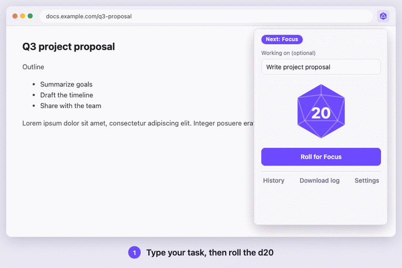

# D20 Focus

Roll a d20 to set how long you focus and how long you break. Focus blocks and breaks take turns, and breaks cover your Chrome tabs. Every session is logged.



## Install
1. Open `chrome://extensions` and turn on **Developer mode**.
2. Click **Load unpacked** and choose this `d20-focus` folder.
3. Pin **D20 Focus** from the puzzle-piece menu.

After changing any file, click **↻ reload** on the extension card.

## Rules
- **Focus:** roll × 2 minutes (2–40). You can change the multiplier in Settings.
- **Break:** `ceil(roll ÷ 4) + 2` minutes (3–7). Every 4th break is a long break of roll minutes.
- **Critical rolls:** a natural 20 on focus lets you add 10 minutes once. A natural 20 on a break gives 20 minutes, and a natural 1 gives 1 minute.
- **Re-roll:** a natural 1 can be re-rolled once, on focus or break.
- **Next phase:** never starts on its own. You always click Roll.
- **Stop:** ends a focus block early with no penalty.
- **Breaks are forced:**
  - There's no Stop during a break.
  - **Pause** (Meeting, Incident, Call or Other) lifts the break screen and logs the pause.
  - After an **Incident**, you can skip the rest of the break.
- **Never blocked:** `claude.ai`, Meet and Zoom never get the break screen. Edit this list in Settings. The break screen never pauses, reloads or closes a page.

## Log
- **History** (in the popup) shows totals, charts and every session, and exports CSV or JSON.
- `~/Downloads/d20-focus/log.json` is rewritten after every session and when you click **Download log**. Claude Code can read it, for example: *"Read ~/Downloads/d20-focus/log.json — how much did I focus this week?"*

## `/focus-stats` in Claude Code
Install the skill once by linking it into your Claude Code skills folder:
```
ln -s "$PWD/claude/skills/focus-stats" ~/.claude/skills/focus-stats
```
Then, in any Claude Code session:
- `/focus-stats`: this week's stats
- `/focus-stats today`, `/focus-stats 7d`, `/focus-stats all`: other date ranges
- `/focus-stats week what did I spend the most time on?`: ask a question about your stats

The skill runs `cli/focus-stats.js`, which you can also run on its own: `node cli/focus-stats.js [range] [--json]`.

## Status line in Claude Code
Shows the timer at the bottom of Claude Code:

```
🎲 14 · Focus · Write project proposal · 23m left · today 1h 05m
```

Add this to `~/.claude/settings.json`:
```json
"statusLine": {
  "type": "command",
  "command": "node /path/to/d20-focus/cli/statusline.js"
}
```
If you already have a status line script, add `--chain <that script>`. The script gets Claude Code's input first, and its output is shown above the D20 line.

Claude Code redraws the status line when the session changes, not every second, so "23m left" is as of the last redraw. The extension updates `log.json` when the timer starts, pauses, resumes or ends.

## Develop
```
npm test     # Node 18+, no dependencies
```

| Path | What it is |
|---|---|
| `lib/dice.js` | Dice rules (pure) |
| `lib/timer.js` | Timer state machine (pure) |
| `lib/stats.js` | Totals, chart data, CSV, log.json (pure) |
| `lib/settings.js` | Settings defaults and validation |
| `lib/store.js` | `chrome.storage` wrapper |
| `background.js` | Service worker: alarms, badge, notifications, chime, break tabs, log.json |
| `content/overlay.js` | Break screen injected into web pages |
| `popup/` | Toolbar popup |
| `pages/` | History, settings, fallback break tab and offscreen audio page |
